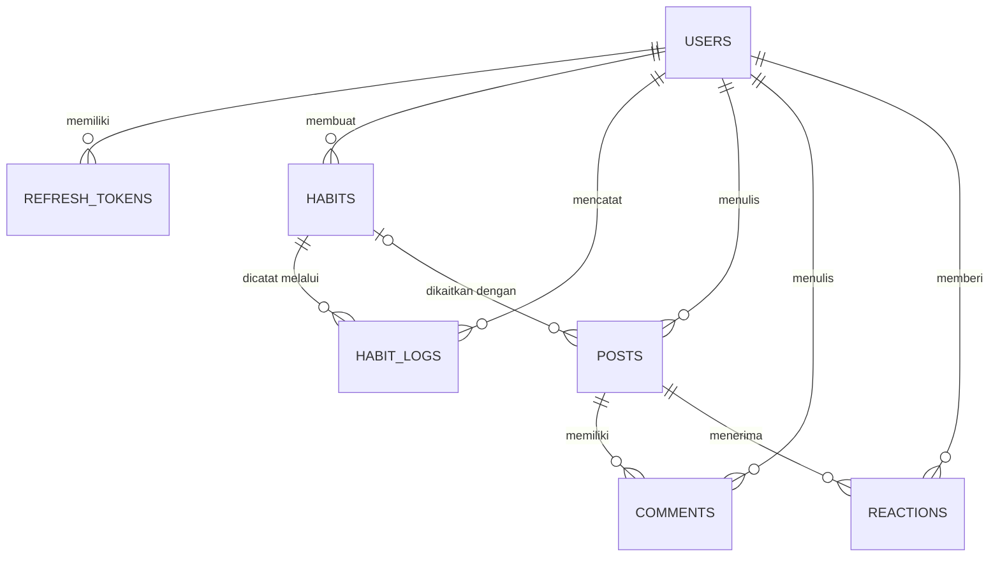
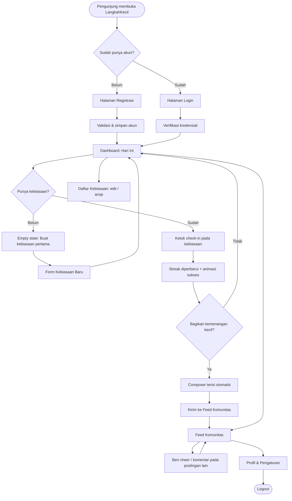
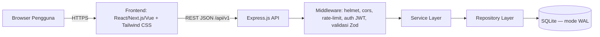

# PRD — LangkahKecil
### Micro-Habit Tracker & Community Accountability Web App

| Atribut | Keterangan |
|---|---|
| **Versi Dokumen** | 1.0 (Draft untuk Review) |
| **Tanggal** | 19 Oktober 2026 |
| **Product Owner** | [Isi nama Anda] |
| **Status** | Draft — siap dipakai sebagai acuan pengembangan MVP |
| **Tech Stack** | Node.js + Express.js · SQLite · REST API (JSON) · React/Next.js/Vue + Tailwind CSS |

---

## Daftar Isi
1. [Executive Summary & Problem Statement](#1-executive-summary--problem-statement)
2. [Target Pengguna & User Persona](#2-target-pengguna--user-persona)
3. [Spesifikasi Fitur (Scope of Work)](#3-spesifikasi-fitur-scope-of-work)
4. [Data Modeling & Database Schema (SQLite)](#4-data-modeling--database-schema-sqlite)
5. [REST API Contract](#5-rest-api-contract)
6. [Alur Pengguna & UI/UX Navigation Flow](#6-alur-pengguna--uiux-navigation-flow)
7. [Non-Functional Requirements](#7-non-functional-requirements)
8. [Out of Scope](#8-out-of-scope)
9. [Lampiran: Arsitektur, Roadmap, Risiko, Definition of Done](#9-lampiran)

---

## 1. Executive Summary & Problem Statement

### 1.1 Ringkasan Eksekutif
**LangkahKecil** adalah aplikasi web pencatat kebiasaan mikro (*micro-habit*) yang berpijak pada prinsip *Atomic Habits*: perubahan besar lahir dari aksi yang sangat kecil tetapi dilakukan konsisten. Contohnya membaca 1 halaman, push-up 3 kali, atau minum 1 gelas air putih.

Aplikasi ini menggabungkan dua komponen inti:
1. **Habit Tracker harian** yang ringan. Pengguna mencentang aksi kecil setiap hari dan melihat *streak* (rangkaian hari berturut-turut) mereka.
2. **Feed komunitas sederhana** untuk membagikan *daily wins* (kemenangan kecil) atau refleksi harian. Pengguna lain dapat memberi **cheer** (reaksi semangat) dan komentar sebagai bentuk *accountability* sosial.

### 1.2 Latar Belakang & Masalah
| # | Masalah | Dampak pada Pengguna |
|---|---|---|
| P1 | Banyak orang menetapkan target kebiasaan yang terlalu besar ("olahraga 1 jam setiap hari"), sehingga cepat menyerah. | Motivasi runtuh dalam 1–2 minggu pertama. |
| P2 | Aplikasi habit tracker umumnya rumit, penuh fitur, dan terasa seperti "pekerjaan tambahan". | Pengguna berhenti mencatat (*tracking fatigue*). |
| P3 | Kebiasaan dibangun sendirian, tanpa dukungan sosial atau rasa tanggung jawab. | Tidak ada dorongan eksternal saat motivasi turun. |
| P4 | Media sosial umum penuh distraksi, perbandingan, dan tekanan tampil sempurna. | Berbagi progres kecil terasa "tidak layak dipamerkan". |

### 1.3 Solusi & Nilai Unik (*Unique Value Proposition*)
- **Mikro by design.** Pembuatan kebiasaan mengarahkan pengguna menulis aksi sangat kecil, dengan opsi *anchor cue* ("Setelah saya … , saya akan …").
- **Check-in satu ketukan.** Mencatat kebiasaan selesai dalam kurang dari 3 detik.
- **Streak yang jujur dan ramah.** Streak dihitung transparan dari data log. Tampilan streak aktif tidak langsung hangus sebelum hari berganti.
- **Komunitas yang suportif, bukan kompetitif.** Tidak ada leaderboard atau jumlah *followers*. Interaksi dibatasi pada *cheer* dan komentar singkat.
- **Self-contained.** Backend Express dan SQLite berjalan sebagai satu layanan sehingga mudah dikembangkan, di-*deploy*, dan dipelajari.

### 1.4 Tujuan & Metrik Keberhasilan (MVP)
| Tujuan | Metrik | Target 60 Hari Pasca Rilis |
|---|---|---|
| Aktivasi | % pengguna baru yang membuat ≥ 1 kebiasaan dalam 24 jam pertama | ≥ 60% |
| Pembentukan kebiasaan | Rata-rata check-in per pengguna aktif per minggu | ≥ 4 hari |
| Retensi | Retensi D7 (kembali di hari ke-7) | ≥ 25% |
| Keterlibatan komunitas | % check-in yang diikuti postingan *daily win* | ≥ 15% |
| Dukungan sosial | Rata-rata *cheer* per postingan | ≥ 2 |
| Kualitas teknis | Waktu respons API p95 (endpoint non-feed) | < 300 ms |

---

## 2. Target Pengguna & User Persona

### 2.1 Segmen Pengguna Utama
- Mahasiswa dan pekerja muda (18–35 tahun) yang ingin membangun rutinitas positif.
- Pengguna yang sudah pernah gagal memakai aplikasi habit tracker kompleks.
- Orang yang termotivasi oleh dukungan sosial yang hangat, bukan kompetisi.

### 2.2 Persona

**Persona 1 — Dinda (21), Mahasiswi Semester 5**
- **Konteks:** Jadwal kuliah padat, sering menunda membaca dan olahraga.
- **Tujuan:** Membaca 1 halaman buku per hari dan peregangan 2 menit.
- **Frustrasi:** Pernah memakai habit tracker lain, tetapi berhenti setelah satu kali melewatkan hari dan streak hilang.
- **Kebutuhan:** Pencatatan super cepat, streak yang tidak menghukum, dan komunitas kecil untuk saling menyemangati.

**Persona 2 — Raka (27), Karyawan Startup**
- **Konteks:** Bekerja dari rumah dan mudah terdistraksi.
- **Tujuan:** Push-up 3 kali setelah bangun tidur, menulis jurnal 1 kalimat sebelum tidur.
- **Frustrasi:** Aplikasi yang ada terlalu banyak pengaturan dan notifikasi.
- **Kebutuhan:** Antarmuka minimalis, ringkasan "hari ini" yang jelas, dan ruang refleksi singkat.

**Persona 3 — Bu Sari (35), Ibu Rumah Tangga & Pelaku UMKM**
- **Konteks:** Waktu luang terbatas dan lebih sering memakai ponsel.
- **Tujuan:** Minum air putih 8 gelas dan jalan kaki 5 menit.
- **Frustrasi:** Merasa minder di media sosial karena orang lain tampak "lebih produktif".
- **Kebutuhan:** UI mobile-first yang besar dan jelas, serta lingkungan yang mengapresiasi kemenangan kecil.

---

## 3. Spesifikasi Fitur (Scope of Work)

### 3.1 Ringkasan Prioritas

| ID | Fitur | Fase | Prioritas |
|---|---|---|---|
| F-01 | Autentikasi (registrasi, login, logout, sesi) | **MVP** | Must |
| F-02 | Manajemen Profil Dasar | **MVP** | Should |
| F-03 | Habit Tracker (CRUD kebiasaan mikro) | **MVP** | Must |
| F-04 | Check-in Harian (Habit Log) & Dashboard "Hari Ini" | **MVP** | Must |
| F-05 | Streak Counter | **MVP** | Must |
| F-06 | Forum/Feed Harian (Daily Wins & Refleksi) | **MVP** | Must |
| F-07 | Komentar & Reaksi (Cheer) | **MVP** | Must |
| F-08 | Verifikasi email & reset password | Fase 2 | Should |
| F-09 | Heatmap/Kalender progres & statistik mingguan | Fase 2 | Should |
| F-10 | Frekuensi kebiasaan kustom (mis. 3×/minggu) | Fase 2 | Should |
| F-11 | Badge & milestone streak (7, 30, 100 hari) | Fase 2 | Could |
| F-12 | Pengingat (email / web push) | Fase 2 | Could |
| F-13 | Follow pengguna & filter feed "Diikuti" | Fase 2 | Could |
| F-14 | Laporan konten (*report*) & moderasi | Fase 2 | Should |
| F-15 | Streak freeze (jeda tanpa memutus streak) | Fase 2 | Could |
| F-16 | Ekspor data (CSV/JSON) & hapus akun | Fase 2 | Could |
| F-17 | Dark mode & preferensi tampilan | Fase 2 | Could |

---

### 3.2 FASE 1 — MVP (Wajib)

#### F-01 Autentikasi
**Deskripsi:** Pengguna mendaftar dan masuk dengan email dan password. Sesi memakai JWT *access token* berumur pendek dan *refresh token* yang dirotasi.

**User Stories & Acceptance Criteria**

**US-AUTH-01 — Registrasi**
> Sebagai pengunjung baru, saya ingin mendaftar dengan email, username, dan password agar dapat memakai LangkahKecil.

- [ ] Form menerima `email`, `username`, `display_name`, `password`.
- [ ] Email harus valid dan unik (tidak peka huruf besar/kecil). Duplikat mengembalikan `409 CONFLICT`.
- [ ] Username 3–20 karakter, hanya `a-z`, `0-9`, `_`, dan unik.
- [ ] Password minimal 8 karakter, maksimal 72 karakter, mengandung minimal 1 huruf dan 1 angka.
- [ ] Password disimpan sebagai hash bcrypt (cost ≥ 12). Password asli tidak pernah disimpan atau dicatat di log.
- [ ] Setelah berhasil, pengguna otomatis login dan diarahkan ke halaman **Hari Ini**.

**US-AUTH-02 — Login**
> Sebagai pengguna terdaftar, saya ingin masuk dengan email dan password agar dapat mengakses kebiasaan saya.

- [ ] Login berhasil mengembalikan `access_token` (JWT, 15 menit) dan menyetel *refresh token* (7 hari) pada cookie `httpOnly`.
- [ ] Kredensial salah mengembalikan `401` dengan pesan generik ("Email atau password salah"), tanpa membedakan email tidak ditemukan dan password salah.
- [ ] Lebih dari 10 percobaan gagal per IP dalam 15 menit mengembalikan `429`.

**US-AUTH-03 — Sesi & Logout**
> Sebagai pengguna, saya ingin tetap masuk dengan aman dan dapat keluar kapan saja.

- [ ] Access token yang kedaluwarsa diperbarui otomatis oleh frontend lewat `POST /auth/refresh`.
- [ ] Refresh token dirotasi pada setiap pemakaian. Token lama langsung dicabut.
- [ ] Logout mencabut refresh token di database dan menghapus cookie.
- [ ] Rute yang membutuhkan autentikasi mengarahkan pengguna yang belum login ke `/login`.

---

#### F-02 Manajemen Profil Dasar
**US-PRO-01 — Ubah profil**
> Sebagai pengguna, saya ingin mengubah nama tampilan, bio, dan zona waktu agar identitas dan perhitungan "hari ini" sesuai.

- [ ] Dapat mengubah `display_name` (1–50 karakter), `bio` (≤ 160 karakter), dan `timezone` (nama IANA yang valid, mis. `Asia/Jakarta`).
- [ ] Email dan username tidak dapat diubah pada MVP.
- [ ] Perubahan zona waktu langsung memengaruhi penentuan "hari ini" pada check-in berikutnya.

---

#### F-03 Habit Tracker (Kelola Kebiasaan Mikro)
**US-HAB-01 — Membuat kebiasaan**
> Sebagai pengguna, saya ingin membuat kebiasaan mikro agar dapat mulai melacaknya.

- [ ] Field: `title` (wajib, 1–80 karakter), `anchor_cue` (opsional, ≤ 120 karakter, mis. "Setelah menyikat gigi"), `description` (opsional, ≤ 200), `emoji`, `color`.
- [ ] Form menampilkan placeholder edukatif ("Buat sekecil mungkin: *baca 1 halaman*").
- [ ] Maksimal **10 kebiasaan aktif** per pengguna. Melebihi batas mengembalikan `422` dengan kode `HABIT_LIMIT_REACHED`.
- [ ] Kebiasaan baru langsung muncul di dashboard Hari Ini.

**US-HAB-02 — Melihat daftar kebiasaan**
> Sebagai pengguna, saya ingin melihat semua kebiasaan aktif beserta streak-nya.

- [ ] Daftar menampilkan judul, emoji, streak saat ini, dan status selesai/belum hari ini.
- [ ] Hanya menampilkan milik pengguna yang sedang login.
- [ ] Tersedia filter `?status=active|archived`.

**US-HAB-03 — Mengubah & mengarsipkan kebiasaan**
> Sebagai pengguna, saya ingin mengedit atau mengarsipkan kebiasaan yang tidak lagi relevan.

- [ ] Semua field dapat diubah, kecuali kepemilikan.
- [ ] "Hapus" bersifat **arsip** (`archived_at` terisi). Riwayat log tetap tersimpan.
- [ ] Kebiasaan arsip tidak tampil di dashboard Hari Ini dan tidak dihitung dalam batas 10 kebiasaan aktif.
- [ ] Mengakses kebiasaan milik pengguna lain mengembalikan `404`, bukan `403`, agar keberadaan data tidak bocor.

---

#### F-04 Check-in Harian (Habit Log) & Dashboard Hari Ini
**US-LOG-01 — Check-in satu ketukan**
> Sebagai pengguna, saya ingin menandai kebiasaan selesai dengan satu ketukan agar pencatatan tidak merepotkan.

- [ ] Satu kebiasaan hanya dapat dicatat **satu kali per tanggal** (`UNIQUE(habit_id, log_date)`). Duplikat mengembalikan `409 ALREADY_LOGGED`.
- [ ] Tanggal default adalah "hari ini" menurut zona waktu pengguna, ditentukan server.
- [ ] Back-date diizinkan hanya untuk **hari ini dan kemarin (H-1)**. Tanggal masa depan atau lebih lama dari H-1 ditolak dengan `422`.
- [ ] Catatan singkat opsional (≤ 200 karakter).
- [ ] Respons memuat streak terbaru agar UI langsung diperbarui (*optimistic update* dengan rollback saat gagal).
- [ ] Setelah check-in, UI menawarkan CTA **"Bagikan kemenangan kecilmu?"** dengan teks yang sudah terisi otomatis.

**US-LOG-02 — Membatalkan check-in**
> Sebagai pengguna, saya ingin membatalkan check-in yang tidak sengaja.

- [ ] Check-in dapat dibatalkan untuk tanggal dalam jendela yang diizinkan (hari ini dan H-1).
- [ ] Streak dihitung ulang otomatis setelah pembatalan.

**US-LOG-03 — Dashboard "Hari Ini"**
> Sebagai pengguna, saya ingin melihat ringkasan kebiasaan hari ini dalam satu layar.

- [ ] Menampilkan tanggal hari ini, progres (mis. "2 dari 4 selesai"), dan daftar kebiasaan dengan tombol check-in.
- [ ] Menampilkan *empty state* yang mengajak pengguna membuat kebiasaan pertama jika belum ada.

---

#### F-05 Streak Counter
**Aturan Bisnis Streak:**
- **Streak saat ini (*current streak*)** adalah jumlah hari berturut-turut yang memiliki log, berakhir pada **hari ini** atau **kemarin**. Jika hari ini belum check-in tetapi kemarin sudah, streak tetap tampil dan belum hangus sampai hari berganti.
- **Streak terpanjang (*longest streak*)** adalah rangkaian hari berturut-turut terpanjang dalam seluruh riwayat kebiasaan tersebut.
- Streak dihitung **per kebiasaan**, bukan global.
- Streak dihitung **di server** dari tabel `habit_logs` (sumber kebenaran tunggal) dengan zona waktu pengguna. Klien tidak pernah mengirim nilai streak.

**US-STR-01 — Melihat streak**
> Sebagai pengguna, saya ingin melihat streak setiap kebiasaan agar termotivasi menjaga konsistensi.

- [ ] Setiap kebiasaan menampilkan `current_streak` dan `longest_streak`.
- [ ] Tiga hari berturut-turut (H-2, H-1, H) menghasilkan `current_streak = 3`.
- [ ] Log pada H-3 dan H-1 (H-2 kosong) menghasilkan `current_streak = 1` jika H-1 adalah hari terakhir, dan `longest_streak` tetap benar.
- [ ] Tidak ada log pada H maupun H-1 menghasilkan `current_streak = 0`.
- [ ] Membatalkan atau menambah log (back-date H-1) langsung memperbarui nilai streak.
- [ ] Pesan UI bernada suportif saat streak putus ("Tidak apa-apa. Mulai lagi hari ini, langkah kecil cukup.").

---

#### F-06 Forum/Feed Harian (Daily Wins & Refleksi)
**US-FEED-01 — Membuat postingan**
> Sebagai pengguna, saya ingin membagikan kemenangan kecil atau refleksi harian agar mendapat dukungan.

- [ ] Field: `body` (wajib, 1–500 karakter), `post_type` (`daily_win` atau `reflection`), dan `habit_id` (opsional, harus milik pengguna).
- [ ] Jika `habit_id` diisi, server menyimpan `streak_snapshot` (streak saat posting) untuk ditampilkan sebagai lencana kecil di kartu postingan.
- [ ] Teks disanitasi dan ditampilkan sebagai *plain text* (tanpa HTML/Markdown pada MVP) untuk mencegah XSS.
- [ ] Batas 10 postingan per pengguna per 24 jam untuk mencegah spam.

**US-FEED-02 — Membaca feed**
> Sebagai pengguna, saya ingin membaca postingan komunitas terbaru.

- [ ] Feed global diurutkan dari yang terbaru dan memakai **cursor pagination** (default 20 item).
- [ ] Setiap kartu menampilkan nama penulis, waktu relatif, isi, lencana kebiasaan/streak (jika ada), jumlah cheer, jumlah komentar, dan reaksi milik pengguna saat ini.
- [ ] Postingan yang dihapus (*soft delete*) tidak tampil.
- [ ] Tersedia filter `?username=` untuk melihat postingan satu pengguna (halaman profil).

**US-FEED-03 — Mengubah & menghapus postingan**
> Sebagai penulis, saya ingin mengedit atau menghapus postingan saya.

- [ ] Hanya penulis yang dapat mengedit (`body`) atau menghapus. Pengguna lain mendapat `403`.
- [ ] Postingan yang diedit menampilkan label "diedit".
- [ ] Menghapus postingan menyembunyikan komentar dan reaksinya dari tampilan.

---

#### F-07 Komentar & Reaksi (Cheer)
**US-INT-01 — Memberi reaksi**
> Sebagai pengguna, saya ingin memberi cheer pada postingan orang lain untuk menyemangati mereka.

- [ ] Jenis reaksi: `cheer` 🎉, `clap` 👏, `fire` 🔥.
- [ ] Satu pengguna memiliki **maksimal satu reaksi per postingan**. Mengirim jenis berbeda mengganti reaksi lama. Mengirim jenis yang sama (atau `DELETE`) membatalkannya.
- [ ] Jumlah reaksi diperbarui seketika di UI (*optimistic update*).
- [ ] Pengguna boleh memberi reaksi pada postingannya sendiri.

**US-INT-02 — Berkomentar**
> Sebagai pengguna, saya ingin menulis komentar pendek agar dapat memberi semangat secara personal.

- [ ] Komentar 1–300 karakter, plain text.
- [ ] Komentar tampil berurutan dari yang terlama ke terbaru, dengan pagination.
- [ ] Penulis komentar atau pemilik postingan dapat menghapus komentar (soft delete).
- [ ] Batas 30 komentar per pengguna per jam.

---

### 3.3 FASE 2 — Nice-to-Have (Opsional)

| ID | Fitur | Gambaran & Kriteria Ringkas |
|---|---|---|
| F-08 | Verifikasi email & reset password | Tautan token sekali pakai (kedaluwarsa 1 jam). Akun belum terverifikasi tidak dapat memposting ke feed. |
| F-09 | Heatmap/kalender & statistik | Kalender 12 minggu per kebiasaan, persentase penyelesaian 7/30 hari. Endpoint `GET /habits/:id/stats`. |
| F-10 | Frekuensi kustom | Target "N kali per minggu". Streak berbasis minggu yang tercapai. Menambah kolom `frequency_type`, `frequency_target`. |
| F-11 | Badge & milestone | Lencana otomatis di 7/30/100 hari. Dapat dibagikan sebagai postingan. |
| F-12 | Pengingat | Email harian atau Web Push pada jam pilihan. Memerlukan job scheduler (mis. `node-cron`). |
| F-13 | Follow & feed "Diikuti" | Tabel `follows`, tab feed "Semua" dan "Diikuti". |
| F-14 | Report & moderasi | Tombol lapor, tabel `reports`, peran `admin`, dan antrean moderasi sederhana. |
| F-15 | Streak freeze | Maksimal 2 "jeda" per bulan yang menjaga streak saat hari terlewat. |
| F-16 | Ekspor & hapus akun | Ekspor CSV/JSON dan penghapusan akun permanen (sesuai praktik privasi data). |
| F-17 | Dark mode | Mengikuti `prefers-color-scheme` dengan *toggle* manual. |

---

## 4. Data Modeling & Database Schema (SQLite)

### 4.1 Konvensi
- **Primary Key:** `INTEGER PRIMARY KEY AUTOINCREMENT`.
- **Waktu:** disimpan sebagai `TEXT` ISO-8601 **UTC** (`YYYY-MM-DDTHH:MM:SS.sssZ`) lewat `strftime`.
- **Tanggal kalender (`log_date`):** `TEXT` format `YYYY-MM-DD`, dalam **zona waktu pengguna**.
- **Boolean/enum:** `INTEGER` 0/1 atau `TEXT` dengan `CHECK` constraint. SQLite tidak memiliki tipe `BOOLEAN`, `DATE`, atau `ENUM` bawaan.
- **Foreign key:** SQLite tidak menegakkan FK secara default, jadi `PRAGMA foreign_keys = ON;` **wajib** dijalankan pada setiap koneksi.
- **Penamaan:** `snake_case`, tabel jamak.

### 4.2 Entity Relationship Diagram



### 4.3 Ringkasan Relasi

| Relasi | Kardinalitas | Perilaku Hapus (ON DELETE) |
|---|---|---|
| users → refresh_tokens | 1 : N | CASCADE |
| users → habits | 1 : N | CASCADE |
| habits → habit_logs | 1 : N | CASCADE |
| users → habit_logs | 1 : N | CASCADE |
| users → posts | 1 : N | CASCADE |
| habits → posts (opsional) | 1 : N | SET NULL |
| posts → comments | 1 : N | CASCADE |
| users → comments | 1 : N | CASCADE |
| posts → reactions | 1 : N | CASCADE |
| users → reactions | 1 : N | CASCADE |

### 4.4 DDL Lengkap

```sql
-- =====================================================
-- LangkahKecil — SQLite Schema v1.0
-- Jalankan pada SETIAP koneksi:
--   PRAGMA foreign_keys = ON;
--   PRAGMA journal_mode = WAL;
--   PRAGMA busy_timeout = 5000;
--   PRAGMA synchronous = NORMAL;
-- =====================================================

-- 1. USERS
CREATE TABLE users (
  id            INTEGER PRIMARY KEY AUTOINCREMENT,
  email         TEXT    NOT NULL COLLATE NOCASE UNIQUE,
  username      TEXT    NOT NULL COLLATE NOCASE UNIQUE
                CHECK (length(username) BETWEEN 3 AND 20),
  display_name  TEXT    NOT NULL CHECK (length(display_name) BETWEEN 1 AND 50),
  password_hash TEXT    NOT NULL,
  bio           TEXT    CHECK (bio IS NULL OR length(bio) <= 160),
  timezone      TEXT    NOT NULL DEFAULT 'Asia/Jakarta',
  created_at    TEXT    NOT NULL DEFAULT (strftime('%Y-%m-%dT%H:%M:%fZ','now')),
  updated_at    TEXT    NOT NULL DEFAULT (strftime('%Y-%m-%dT%H:%M:%fZ','now'))
);

-- 2. REFRESH_TOKENS (disimpan dalam bentuk hash SHA-256)
CREATE TABLE refresh_tokens (
  id          INTEGER PRIMARY KEY AUTOINCREMENT,
  user_id     INTEGER NOT NULL REFERENCES users(id) ON DELETE CASCADE,
  token_hash  TEXT    NOT NULL UNIQUE,
  expires_at  TEXT    NOT NULL,
  revoked_at  TEXT,
  created_at  TEXT    NOT NULL DEFAULT (strftime('%Y-%m-%dT%H:%M:%fZ','now'))
);
CREATE INDEX idx_refresh_tokens_user ON refresh_tokens(user_id);

-- 3. HABITS
CREATE TABLE habits (
  id           INTEGER PRIMARY KEY AUTOINCREMENT,
  user_id      INTEGER NOT NULL REFERENCES users(id) ON DELETE CASCADE,
  title        TEXT    NOT NULL CHECK (length(title) BETWEEN 1 AND 80),
  anchor_cue   TEXT    CHECK (anchor_cue IS NULL OR length(anchor_cue) <= 120),
  description  TEXT    CHECK (description IS NULL OR length(description) <= 200),
  emoji        TEXT    NOT NULL DEFAULT '🌱',
  color        TEXT    NOT NULL DEFAULT '#10B981'
               CHECK (color GLOB '#[0-9A-Fa-f][0-9A-Fa-f][0-9A-Fa-f][0-9A-Fa-f][0-9A-Fa-f][0-9A-Fa-f]'),
  archived_at  TEXT,
  created_at   TEXT    NOT NULL DEFAULT (strftime('%Y-%m-%dT%H:%M:%fZ','now')),
  updated_at   TEXT    NOT NULL DEFAULT (strftime('%Y-%m-%dT%H:%M:%fZ','now'))
);
CREATE INDEX idx_habits_user_active ON habits(user_id, archived_at);

-- 4. HABIT_LOGS (satu log per kebiasaan per tanggal)
CREATE TABLE habit_logs (
  id          INTEGER PRIMARY KEY AUTOINCREMENT,
  habit_id    INTEGER NOT NULL REFERENCES habits(id) ON DELETE CASCADE,
  user_id     INTEGER NOT NULL REFERENCES users(id)  ON DELETE CASCADE,
  log_date    TEXT    NOT NULL
              CHECK (log_date GLOB '[0-9][0-9][0-9][0-9]-[0-9][0-9]-[0-9][0-9]'),
  note        TEXT    CHECK (note IS NULL OR length(note) <= 200),
  created_at  TEXT    NOT NULL DEFAULT (strftime('%Y-%m-%dT%H:%M:%fZ','now')),
  UNIQUE (habit_id, log_date)
);
CREATE INDEX idx_habit_logs_user_date ON habit_logs(user_id, log_date);

-- 5. POSTS (Daily Wins & Refleksi)
CREATE TABLE posts (
  id              INTEGER PRIMARY KEY AUTOINCREMENT,
  user_id         INTEGER NOT NULL REFERENCES users(id)  ON DELETE CASCADE,
  habit_id        INTEGER REFERENCES habits(id) ON DELETE SET NULL,
  post_type       TEXT    NOT NULL DEFAULT 'daily_win'
                  CHECK (post_type IN ('daily_win','reflection')),
  body            TEXT    NOT NULL CHECK (length(body) BETWEEN 1 AND 500),
  streak_snapshot INTEGER CHECK (streak_snapshot IS NULL OR streak_snapshot >= 0),
  created_at      TEXT    NOT NULL DEFAULT (strftime('%Y-%m-%dT%H:%M:%fZ','now')),
  updated_at      TEXT    NOT NULL DEFAULT (strftime('%Y-%m-%dT%H:%M:%fZ','now')),
  deleted_at      TEXT
);
CREATE INDEX idx_posts_feed ON posts(deleted_at, id DESC);
CREATE INDEX idx_posts_user ON posts(user_id, id DESC);

-- 6. COMMENTS
CREATE TABLE comments (
  id          INTEGER PRIMARY KEY AUTOINCREMENT,
  post_id     INTEGER NOT NULL REFERENCES posts(id) ON DELETE CASCADE,
  user_id     INTEGER NOT NULL REFERENCES users(id) ON DELETE CASCADE,
  body        TEXT    NOT NULL CHECK (length(body) BETWEEN 1 AND 300),
  created_at  TEXT    NOT NULL DEFAULT (strftime('%Y-%m-%dT%H:%M:%fZ','now')),
  deleted_at  TEXT
);
CREATE INDEX idx_comments_post ON comments(post_id, id);

-- 7. REACTIONS (maksimal satu reaksi per pengguna per postingan)
CREATE TABLE reactions (
  id          INTEGER PRIMARY KEY AUTOINCREMENT,
  post_id     INTEGER NOT NULL REFERENCES posts(id) ON DELETE CASCADE,
  user_id     INTEGER NOT NULL REFERENCES users(id) ON DELETE CASCADE,
  type        TEXT    NOT NULL CHECK (type IN ('cheer','clap','fire')),
  created_at  TEXT    NOT NULL DEFAULT (strftime('%Y-%m-%dT%H:%M:%fZ','now')),
  UNIQUE (post_id, user_id)
);
CREATE INDEX idx_reactions_post ON reactions(post_id);
```

### 4.5 Kamus Data Ringkas

| Tabel | Kolom Kunci | Catatan |
|---|---|---|
| `users` | `email`, `username` (UNIQUE, NOCASE) | `password_hash` tidak pernah dikembalikan oleh API. |
| `refresh_tokens` | `token_hash` | Token mentah tidak disimpan. Mendukung rotasi dan pencabutan. |
| `habits` | `archived_at` | `NULL` berarti aktif. Terisi berarti diarsipkan (soft delete). |
| `habit_logs` | `UNIQUE(habit_id, log_date)` | Menjamin idempotensi check-in per hari. |
| `posts` | `streak_snapshot`, `deleted_at` | Snapshot streak saat posting. Soft delete untuk moderasi dan konsistensi. |
| `comments` | `post_id`, `deleted_at` | Urut berdasarkan `id` ascending. |
| `reactions` | `UNIQUE(post_id, user_id)` | Mengganti jenis reaksi berarti `UPDATE`. Membatalkan berarti `DELETE`. |

### 4.6 Algoritma Streak (Gaps-and-Islands)

Streak dihitung saat dibaca dengan memanfaatkan indeks `(habit_id, log_date)`. Parameter `:today` adalah tanggal "hari ini" pengguna (`YYYY-MM-DD`).

```sql
WITH numbered AS (
  SELECT log_date,
         julianday(log_date) - ROW_NUMBER() OVER (ORDER BY log_date) AS grp
  FROM habit_logs
  WHERE habit_id = :habit_id
),
islands AS (
  SELECT MIN(log_date) AS start_date,
         MAX(log_date) AS end_date,
         COUNT(*)      AS len
  FROM numbered
  GROUP BY grp
)
SELECT
  COALESCE((SELECT len FROM islands
            WHERE end_date >= date(:today, '-1 day')
            ORDER BY end_date DESC LIMIT 1), 0) AS current_streak,
  COALESCE((SELECT MAX(len) FROM islands), 0)   AS longest_streak;
```

> **Catatan:** Untuk kebutuhan skala kecil–menengah, perhitungan dinamis ini cukup cepat. Jika kelak diperlukan, hasil dapat dicache pada kolom turunan di tabel `habits` yang diperbarui dalam satu transaksi dengan penulisan log.

---

## 5. REST API Contract

### 5.1 Konvensi Umum
- **Base URL:** `/api/v1`
- **Format:** `application/json; charset=utf-8`
- **Autentikasi:** header `Authorization: Bearer <access_token>` untuk semua endpoint bertanda 🔒.
- **ID** pada path berupa integer.
- **Tanggal:** timestamp ISO-8601 UTC. `log_date` berformat `YYYY-MM-DD`.

**Envelope Sukses**
```json
{ "success": true, "data": { }, "meta": { } }
```

**Envelope Error**
```json
{
  "success": false,
  "error": {
    "code": "VALIDATION_ERROR",
    "message": "Data yang dikirim tidak valid.",
    "details": [ { "field": "email", "message": "Format email tidak valid" } ]
  }
}
```

**Kode Status & Error**

| HTTP | `error.code` | Keterangan |
|---|---|---|
| 400 | `BAD_REQUEST` | JSON rusak atau parameter tidak dapat diurai. |
| 401 | `UNAUTHORIZED` / `TOKEN_EXPIRED` | Token tidak ada, tidak valid, atau kedaluwarsa. |
| 403 | `FORBIDDEN` | Terautentikasi tetapi bukan pemilik sumber daya. |
| 404 | `NOT_FOUND` | Sumber daya tidak ada atau bukan milik pengguna (untuk data privat). |
| 409 | `CONFLICT` / `ALREADY_LOGGED` | Duplikat email/username atau check-in ganda. |
| 422 | `VALIDATION_ERROR` / `HABIT_LIMIT_REACHED` | Aturan validasi atau bisnis dilanggar. |
| 429 | `RATE_LIMITED` | Terlalu banyak permintaan. |
| 500 | `INTERNAL_ERROR` | Kesalahan server (detail tidak diekspos ke klien). |

### 5.2 Autentikasi & Profil

| Method | Path | Auth | Request Body | Sukses | Error |
|---|---|---|---|---|---|
| POST | `/auth/register` | – | `{ email, username, display_name, password }` | **201** `{ user, access_token }` + cookie refresh | 409, 422, 429 |
| POST | `/auth/login` | – | `{ email, password }` | **200** `{ user, access_token }` + cookie refresh | 401, 422, 429 |
| POST | `/auth/refresh` | cookie | – | **200** `{ access_token }` (refresh dirotasi) | 401 |
| POST | `/auth/logout` | 🔒 | – | **204** (token dicabut, cookie dihapus) | 401 |
| GET | `/users/me` | 🔒 | – | **200** `{ user }` | 401 |
| PATCH | `/users/me` | 🔒 | `{ display_name?, bio?, timezone? }` | **200** `{ user }` | 401, 422 |

### 5.3 Habits

| Method | Path | Auth | Request Body / Query | Sukses | Error |
|---|---|---|---|---|---|
| GET | `/habits` | 🔒 | Query: `status=active\|archived` (default `active`) | **200** `{ habits[] }` + streak & `completed_today` | 401 |
| POST | `/habits` | 🔒 | `{ title, anchor_cue?, description?, emoji?, color? }` | **201** `{ habit }` | 401, 422 (`HABIT_LIMIT_REACHED`) |
| GET | `/habits/:habitId` | 🔒 | – | **200** `{ habit }` | 401, 404 |
| PATCH | `/habits/:habitId` | 🔒 | Field di atas (parsial) | **200** `{ habit }` | 401, 404, 422 |
| DELETE | `/habits/:habitId` | 🔒 | – | **204** (diarsipkan) | 401, 404 |
| POST | `/habits/:habitId/restore` | 🔒 | – | **200** `{ habit }` | 401, 404, 422 |
| GET | `/dashboard/today` | 🔒 | – | **200** `{ date, progress, habits[] }` | 401 |

### 5.4 Habit Logs (Check-in)

| Method | Path | Auth | Request Body / Query | Sukses | Error |
|---|---|---|---|---|---|
| POST | `/habits/:habitId/logs` | 🔒 | `{ log_date?, note? }` (default: hari ini pengguna) | **201** `{ log, streak }` | 401, 404, 409 (`ALREADY_LOGGED`), 422 |
| DELETE | `/habits/:habitId/logs/:logDate` | 🔒 | – | **200** `{ streak }` | 401, 404, 422 |
| GET | `/habits/:habitId/logs` | 🔒 | Query: `from`, `to` (`YYYY-MM-DD`, maks. rentang 92 hari) | **200** `{ logs[] }` | 401, 404, 422 |
| GET | `/habits/:habitId/streak` | 🔒 | – | **200** `{ current_streak, longest_streak, last_log_date }` | 401, 404 |

### 5.5 Posts, Comments & Reactions

| Method | Path | Auth | Request Body / Query | Sukses | Error |
|---|---|---|---|---|---|
| GET | `/posts` | 🔒 | Query: `limit` (1–50, default 20), `cursor`, `username?`, `post_type?` | **200** `{ posts[] }` + `meta.next_cursor` | 401, 400 |
| POST | `/posts` | 🔒 | `{ body, post_type?, habit_id? }` | **201** `{ post }` | 401, 404 (habit), 422, 429 |
| GET | `/posts/:postId` | 🔒 | – | **200** `{ post }` | 401, 404 |
| PATCH | `/posts/:postId` | 🔒 | `{ body }` | **200** `{ post }` | 401, 403, 404, 422 |
| DELETE | `/posts/:postId` | 🔒 | – | **204** (soft delete) | 401, 403, 404 |
| GET | `/posts/:postId/comments` | 🔒 | Query: `limit` (default 20), `cursor` | **200** `{ comments[] }` + `meta.next_cursor` | 401, 404 |
| POST | `/posts/:postId/comments` | 🔒 | `{ body }` | **201** `{ comment }` | 401, 404, 422, 429 |
| DELETE | `/comments/:commentId` | 🔒 | – | **204** (penulis komentar atau pemilik postingan) | 401, 403, 404 |
| PUT | `/posts/:postId/reaction` | 🔒 | `{ type: "cheer"\|"clap"\|"fire" }` | **200** `{ my_reaction, reaction_count }` | 401, 404, 422 |
| DELETE | `/posts/:postId/reaction` | 🔒 | – | **200** `{ my_reaction: null, reaction_count }` | 401, 404 |

> **Idempotensi:** `PUT /posts/:postId/reaction` bersifat idempoten (upsert). `DELETE` pada reaksi yang tidak ada tetap mengembalikan `200`.

### 5.6 Contoh Request & Response Kunci

**`POST /auth/register`**
```json
// Request
{
  "email": "dinda@example.com",
  "username": "dinda_baca",
  "display_name": "Dinda",
  "password": "LangkahKecil1"
}

// Response 201
{
  "success": true,
  "data": {
    "user": {
      "id": 1,
      "email": "dinda@example.com",
      "username": "dinda_baca",
      "display_name": "Dinda",
      "bio": null,
      "timezone": "Asia/Jakarta",
      "created_at": "2026-10-19T12:00:00.000Z"
    },
    "access_token": "eyJhbGciOiJIUzI1NiIsInR5cCI6IkpXVCJ9..."
  }
}
```

**`POST /habits`**
```json
// Request
{
  "title": "Baca 1 halaman buku",
  "anchor_cue": "Setelah menyikat gigi malam",
  "emoji": "📖",
  "color": "#6366F1"
}

// Response 201
{
  "success": true,
  "data": {
    "habit": {
      "id": 7,
      "title": "Baca 1 halaman buku",
      "anchor_cue": "Setelah menyikat gigi malam",
      "description": null,
      "emoji": "📖",
      "color": "#6366F1",
      "archived_at": null,
      "streak": { "current_streak": 0, "longest_streak": 0 },
      "completed_today": false,
      "created_at": "2026-10-19T12:05:00.000Z"
    }
  }
}
```

**`POST /habits/7/logs` (check-in)**
```json
// Request
{ "note": "Baca satu halaman, rasanya ringan." }

// Response 201
{
  "success": true,
  "data": {
    "log": { "id": 42, "habit_id": 7, "log_date": "2026-10-19", "note": "Baca satu halaman, rasanya ringan." },
    "streak": { "current_streak": 5, "longest_streak": 9 }
  }
}
```

**Response 409 (check-in ganda)**
```json
{
  "success": false,
  "error": { "code": "ALREADY_LOGGED", "message": "Kebiasaan ini sudah dicatat untuk tanggal tersebut." }
}
```

**`POST /posts`**
```json
// Request
{
  "body": "Hari ini cuma baca 1 halaman, tapi streak sudah 5 hari! 🎉",
  "post_type": "daily_win",
  "habit_id": 7
}

// Response 201
{
  "success": true,
  "data": {
    "post": {
      "id": 130,
      "body": "Hari ini cuma baca 1 halaman, tapi streak sudah 5 hari! 🎉",
      "post_type": "daily_win",
      "streak_snapshot": 5,
      "habit": { "id": 7, "title": "Baca 1 halaman buku", "emoji": "📖" },
      "author": { "id": 1, "username": "dinda_baca", "display_name": "Dinda" },
      "reaction_count": 0,
      "comment_count": 0,
      "my_reaction": null,
      "is_edited": false,
      "created_at": "2026-10-19T12:10:00.000Z"
    }
  }
}
```

**`GET /posts?limit=2`**
```json
{
  "success": true,
  "data": { "posts": [ { "id": 130, "...": "..." }, { "id": 129, "...": "..." } ] },
  "meta": { "limit": 2, "next_cursor": "129", "has_more": true }
}
```
> **Cursor:** `cursor` berisi `id` postingan terakhir. Query berikutnya memakai `WHERE id < :cursor ORDER BY id DESC LIMIT :limit`.

**`PUT /posts/130/reaction`**
```json
// Request
{ "type": "cheer" }

// Response 200
{ "success": true, "data": { "my_reaction": "cheer", "reaction_count": 1 } }
```

---

## 6. Alur Pengguna & UI/UX Navigation Flow

### 6.1 Diagram Alur Utama



### 6.2 Peta Halaman (Sitemap)

| Rute | Halaman | Akses | Isi Utama |
|---|---|---|---|
| `/` | Landing | Publik | Value proposition singkat, tombol *Mulai Gratis*. |
| `/register` | Registrasi | Publik | Form daftar. |
| `/login` | Login | Publik | Form masuk. |
| `/today` | **Hari Ini** (beranda) | 🔒 | Progres harian, daftar kebiasaan, tombol check-in. |
| `/habits` | Kebiasaan Saya | 🔒 | Daftar aktif/arsip, tombol tambah. |
| `/habits/new` | Buat Kebiasaan | 🔒 | Form kebiasaan mikro. |
| `/habits/[id]` | Detail Kebiasaan | 🔒 | Streak, riwayat log 30 hari, edit/arsip. |
| `/community` | Feed Komunitas | 🔒 | Composer, daftar postingan, *infinite scroll*. |
| `/community/[postId]` | Detail Postingan | 🔒 | Postingan lengkap, reaksi, daftar komentar. |
| `/u/[username]` | Profil Publik | 🔒 | Info pengguna dan postingan miliknya. |
| `/settings` | Pengaturan Profil | 🔒 | Ubah nama, bio, zona waktu, logout. |

### 6.3 Navigasi
- **Mobile:** *bottom navigation bar* dengan 4 tab: **Hari Ini · Kebiasaan · Komunitas · Profil**. Tombol aksi mengambang (FAB) "+" tersedia di tab Kebiasaan dan Komunitas.
- **Desktop:** sidebar kiri dengan item yang sama dan konten utama di tengah (maks. lebar 720 px).

### 6.4 Wireframe Deskriptif Halaman Utama

**Hari Ini (`/today`)**
1. *Header:* sapaan ("Selamat malam, Dinda 👋") dan tanggal.
2. *Kartu progres:* cincin/bar "2 dari 4 selesai".
3. *Daftar kebiasaan:* kartu dengan emoji, judul, *anchor cue* (teks kecil), lencana 🔥 streak, dan **tombol check-in besar** (area sentuh ≥ 44×44 px).
4. *State:* belum selesai (outline), selesai (terisi dan tercentang dengan animasi ringan), memuat (skeleton).
5. *Setelah check-in:* *toast* atau *bottom sheet* "Bagikan kemenangan kecilmu?" dengan tombol **Bagikan** dan **Nanti saja**.

**Feed Komunitas (`/community`)**
1. *Composer:* area teks dengan penghitung karakter (500), *toggle* tipe (Daily Win/Refleksi), dan *dropdown* opsional "Kaitkan kebiasaan".
2. *Kartu postingan:* avatar inisial, nama, waktu relatif, isi, lencana "📖 Baca 1 halaman · 🔥 5 hari", baris aksi **[🎉 Cheer · 12] [💬 Komentar · 3]**.
3. *Pemilih reaksi:* tekan lama atau menu kecil untuk memilih 🎉 👏 🔥.
4. *Pagination:* *infinite scroll* dengan tombol "Muat lebih banyak" sebagai *fallback*.

### 6.5 Status UI Wajib (Semua Halaman Data)
- *Loading:* skeleton, bukan spinner penuh layar.
- *Empty:* pesan ramah dan CTA.
- *Error:* pesan jelas dengan tombol **Coba lagi**.
- *Form:* validasi inline dengan teks bahasa Indonesia, tombol dinonaktifkan saat *submitting*.

---

## 7. Non-Functional Requirements

### 7.1 Keamanan
| Area | Persyaratan |
|---|---|
| **Hashing password** | bcrypt dengan cost ≥ 12. Panjang password dibatasi 72 karakter sesuai batas bcrypt. |
| **JWT** | Access token HS256 (atau RS256), kedaluwarsa 15 menit, berisi `sub` (user id) dan `iat`/`exp`. Secret berasal dari variabel lingkungan (≥ 32 byte acak), tidak pernah di-commit. |
| **Refresh token** | Acak 256-bit, disimpan **hash**-nya di DB, cookie `httpOnly; Secure; SameSite=Lax`, rotasi pada setiap pemakaian, dan masa berlaku 7 hari. |
| **Otorisasi** | Setiap query data privat selalu menyertakan `user_id` dari token (pencegahan IDOR). Tidak pernah mempercayai `user_id` dari body. |
| **SQL Injection** | Seluruh query memakai *prepared statements*/parameter binding (mis. `better-sqlite3`). Dilarang menyusun SQL dengan *string concatenation*. |
| **XSS** | Konten pengguna ditampilkan sebagai teks (tanpa `dangerouslySetInnerHTML`). Server menormalisasi dan memangkas spasi. Header CSP lewat `helmet`. |
| **CORS & Header** | CORS *allowlist* untuk origin frontend. Memakai `helmet` (HSTS, `X-Content-Type-Options`, dll.). |
| **Rate limiting** | Login/registrasi 10 permintaan/15 menit/IP. Endpoint tulis 60 permintaan/menit/pengguna. Batas harian pada postingan dan komentar sesuai bagian 3. |
| **Transport** | HTTPS wajib di produksi. |
| **Log & privasi** | Tidak mencatat password, token, atau isi `Authorization` pada log. Pesan error tidak membocorkan detail internal. |
| **Dependensi** | `npm audit` pada CI. Kunci versi dengan `package-lock.json`. |

### 7.2 Performa & Database SQLite
| Aspek | Persyaratan |
|---|---|
| **Target latensi** | p95 < 300 ms untuk endpoint umum dan < 500 ms untuk `GET /posts` pada 10.000 postingan. |
| **Mode jurnal** | `PRAGMA journal_mode = WAL` agar pembaca tidak memblokir penulis. |
| **Concurrency** | `busy_timeout = 5000`. Operasi tulis berupa transaksi singkat. Satu *instance* proses penulis (SQLite *single-writer*). |
| **Indeks** | Sesuai DDL pada bagian 4. Query yang lambat dianalisis dengan `EXPLAIN QUERY PLAN`. |
| **Hindari N+1** | Feed mengambil jumlah reaksi/komentar dan `my_reaction` dalam satu query (JOIN atau subquery terkorelasi). |
| **Pagination** | Semua daftar memakai batas (`limit` maks. 50) dan cursor berbasis `id`. |
| **Transaksi** | Operasi gabungan (mis. posting beserta *snapshot* streak) dijalankan dalam satu transaksi. |
| **Backup** | Cadangan harian memakai `.backup`/`VACUUM INTO`, retensi 7 hari, dan uji pemulihan minimal sekali sebelum rilis. |
| **Migrasi** | Skema dikelola dengan berkas migrasi berurutan (mis. `migrations/001_init.sql`). Tidak ada perubahan skema manual di produksi. |
| **Jalur skala** | Lapisan akses data dipisahkan (*repository pattern*) agar migrasi ke PostgreSQL di masa depan tidak mengubah *service layer*. |

### 7.3 Validasi Data
- Validasi di **dua lapis**: (1) frontend untuk UX, (2) backend sebagai otoritas dengan skema (mis. **Zod** atau **Joi**), ditambah `CHECK` constraint di database sebagai lapisan terakhir.
- Respons validasi selalu berformat `VALIDATION_ERROR` dengan daftar `details` per-field.

| Field | Aturan |
|---|---|
| `email` | Format valid, ≤ 254 karakter, dinormalisasi *lowercase*, unik. |
| `username` | `^[a-z0-9_]{3,20}$`, unik. |
| `display_name` | 1–50 karakter, tanpa karakter kontrol. |
| `password` | 8–72 karakter, ≥ 1 huruf dan ≥ 1 angka. |
| `timezone` | Nama IANA valid (mis. via `Intl.supportedValuesOf('timeZone')`). |
| `habit.title` | 1–80 karakter. |
| `habit.color` | Hex `#RRGGBB`. |
| `log_date` | `YYYY-MM-DD` valid, tidak di masa depan, dan hanya H atau H-1. |
| `post.body` | 1–500 karakter setelah *trim*. |
| `comment.body` | 1–300 karakter setelah *trim*. |
| `reaction.type` | Salah satu dari `cheer`, `clap`, `fire`. |

### 7.4 Responsivitas & Aksesibilitas UI
- **Mobile-first** dengan Tailwind CSS. Titik henti: `sm 640`, `md 768`, `lg 1024`, `xl 1280`.
- Seluruh fitur MVP harus berfungsi penuh pada lebar layar **360 px** tanpa *scroll* horizontal.
- Area sentuh interaktif ≥ 44×44 px.
- Kontras warna memenuhi **WCAG 2.1 AA** (rasio ≥ 4.5:1 untuk teks).
- Navigasi dan form dapat dipakai dengan keyboard. Elemen interaktif memiliki *focus ring*, label, dan atribut ARIA yang sesuai.
- Skor Lighthouse target: Performance ≥ 85 dan Accessibility ≥ 90 (mobile).
- Mendukung dua versi utama peramban modern (Chrome, Firefox, Safari, Edge).

### 7.5 Keandalan, Observabilitas & Kualitas Kode
- **Logging terstruktur** (mis. `pino`) dengan *request id*. Endpoint `GET /health` untuk pemeriksaan kesehatan.
- **Penanganan error terpusat** lewat *error-handling middleware* Express.
- **Pengujian:** unit test (Jest/Vitest), integrasi API (Supertest) dengan database SQLite in-memory/temporer, target cakupan ≥ 70% pada logika bisnis (streak, validasi, otorisasi).
- **Kualitas:** ESLint + Prettier, *commit* mengikuti Conventional Commits, dan CI menjalankan lint, test, dan audit.
- **Konfigurasi:** variabel lingkungan (`PORT`, `JWT_SECRET`, `DB_PATH`, `CORS_ORIGIN`) divalidasi saat *startup*, dan layanan menolak berjalan jika tidak lengkap.
- **Dokumentasi API:** spesifikasi OpenAPI/Swagger yang selaras dengan bagian 5 (disarankan).

---

## 8. Out of Scope

Hal-hal berikut **sengaja tidak dikerjakan** pada versi 1.0 agar tim fokus pada MVP:

| # | Tidak Termasuk | Alasan |
|---|---|---|
| 1 | Pesan langsung (DM), obrolan, atau grup privat | Kompleksitas moderasi dan *real-time*. |
| 2 | Sistem *follow*/teman dan feed personalisasi | Ditunda ke Fase 2 (F-13). |
| 3 | Notifikasi (push, email, in-app) dan pengingat | Membutuhkan penjadwal dan infrastruktur tambahan (F-12). |
| 4 | Login sosial (Google, GitHub, dll.) | Cukup email + password untuk MVP. |
| 5 | Verifikasi email dan reset password | Ditunda ke Fase 2 (F-08). |
| 6 | Unggah gambar/video/avatar | Menambah kebutuhan penyimpanan dan moderasi. |
| 7 | Leaderboard, peringkat, dan fitur kompetisi | Bertentangan dengan filosofi komunitas suportif. |
| 8 | Badge, poin, dan gamifikasi lanjutan | Fase 2 (F-11). |
| 9 | Frekuensi kebiasaan non-harian (mingguan, bulanan, hari tertentu) | Fase 2 (F-10). |
| 10 | Analitik lanjutan, heatmap, dan ekspor data | Fase 2 (F-09, F-16). |
| 11 | Panel admin dan alur moderasi/pelaporan | Fase 2 (F-14). Pada MVP pengguna hanya dapat menghapus kontennya sendiri. |
| 12 | Aplikasi *native* mobile atau PWA offline-first | Fokus pada web responsif. |
| 13 | Komunikasi *real-time* (WebSocket/SSE) | Feed memakai *polling*/*refetch* sederhana. |
| 14 | Multi-bahasa (i18n) | Antarmuka berbahasa Indonesia saja. |
| 15 | Monetisasi, langganan, dan pembayaran | Di luar tujuan validasi MVP. |
| 16 | Fitur berbasis AI (rekomendasi kebiasaan, ringkasan) | Di luar cakupan. |
| 17 | Penskalaan horizontal / multi-instance dan migrasi ke PostgreSQL | Tidak diperlukan pada skala MVP. |

---

## 9. Lampiran

### 9.1 Arsitektur Tingkat Tinggi



> **Rekomendasi deployment:** layani frontend dan API di **domain yang sama** (mis. reverse proxy: `/` untuk frontend dan `/api` untuk Express) agar cookie refresh token berfungsi aman dengan `SameSite=Lax`.

### 9.2 Struktur Folder Backend yang Disarankan

```text
backend/
├── src/
│   ├── app.js              # Konfigurasi Express & middleware
│   ├── server.js           # Entry point
│   ├── config/             # Env & konstanta
│   ├── db/
│   │   ├── connection.js   # Inisialisasi SQLite + PRAGMA
│   │   └── migrations/     # 001_init.sql, ...
│   ├── middlewares/        # auth, validate, rateLimit, errorHandler
│   ├── modules/
│   │   ├── auth/           # routes, controller, service, schema
│   │   ├── users/
│   │   ├── habits/
│   │   ├── logs/           # termasuk perhitungan streak
│   │   ├── posts/
│   │   ├── comments/
│   │   └── reactions/
│   └── utils/              # date/timezone helper, response helper
├── tests/
├── .env.example
└── package.json
```

### 9.3 Roadmap Pengembangan MVP (Estimasi 6 Minggu)

| Minggu | Fokus | Output |
|---|---|---|
| 1 | Fondasi proyek | Struktur repo, skema SQLite + migrasi, konfigurasi Express, CI dasar. |
| 2 | Autentikasi & profil | Register, login, refresh, logout, `/users/me`, UI auth. |
| 3 | Habit & check-in | CRUD kebiasaan, log harian, dashboard Hari Ini. |
| 4 | Streak & polishing tracker | Algoritma streak + pengujian kasus tepi, UI streak, empty/loading state. |
| 5 | Komunitas | Feed, composer, komentar, reaksi, cursor pagination. |
| 6 | Hardening & rilis | Uji keamanan, uji performa, aksesibilitas, backup, dokumentasi, *deployment*. |

### 9.4 Risiko & Mitigasi

| Risiko | Dampak | Mitigasi |
|---|---|---|
| Batas *single-writer* SQLite saat trafik tulis tinggi | Latensi naik/`SQLITE_BUSY` | WAL, transaksi singkat, `busy_timeout`, *repository pattern* untuk migrasi di masa depan. |
| Kesalahan perhitungan streak akibat zona waktu | Kepercayaan pengguna turun | Hitung di server dengan zona waktu pengguna, uji kasus batas tengah malam dan pergantian zona waktu. |
| Spam/konten tidak pantas di feed | Komunitas tidak sehat | Rate limit, batas harian, plain text, hapus konten sendiri, dan moderasi di Fase 2. |
| Pengguna berhenti setelah streak putus | Retensi rendah | Pesan suportif, streak aktif tidak hangus sebelum hari berganti, streak freeze di Fase 2. |
| Kebocoran data antar pengguna (IDOR) | Pelanggaran privasi | Otorisasi berbasis `user_id` token pada setiap query dan pengujian otorisasi otomatis. |
| Kehilangan data (file SQLite rusak/terhapus) | Data hilang | Backup harian terjadwal dan uji pemulihan. |

### 9.5 Asumsi
1. Pengguna memiliki satu zona waktu aktif pada satu waktu (dapat diubah di pengaturan).
2. Komunitas pada MVP bersifat **global dan terbuka** bagi seluruh pengguna terdaftar.
3. Skala awal yang direncanakan: ≤ 5.000 pengguna dan ≤ 100 permintaan tulis per menit.
4. Pilihan *framework* frontend (React/Next.js/Vue) ditentukan tim. Kontrak API pada dokumen ini bersifat *framework-agnostic*.

### 9.6 Definition of Done (Per Fitur)
- [ ] Seluruh *Acceptance Criteria* terpenuhi dan terverifikasi.
- [ ] Endpoint sesuai kontrak (path, method, body, status code, format error).
- [ ] Validasi backend, otorisasi, dan *rate limit* berfungsi.
- [ ] Unit/integrasi test lulus dan CI hijau.
- [ ] UI responsif (≥ 360 px), memiliki state loading/empty/error, dan lolos pemeriksaan aksesibilitas dasar.
- [ ] Dokumentasi (README/OpenAPI) diperbarui dan *code review* disetujui.

---
*Akhir dokumen PRD LangkahKecil v1.0*